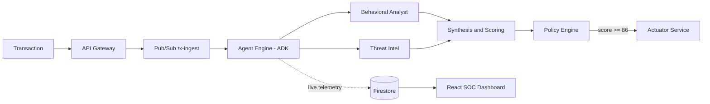

# 01 · Project Analysis — Aegis AI Fraud Ops

| Field | Value |
|-------|-------|
| Document owner | Tech Lead |
| Status | ✅ Approved baseline (v1.0) |
| Supersedes | `PROJECT_SPEC.md` (v0) |
| Last updated | 2026-10-09 |

---

## 1. Executive Summary

**Aegis AI Fraud Ops** is a real-time fraud investigation platform for tier-1 banks. Rule engines only say *"blocked"*. Aegis instead runs a **hierarchical group of Gemini-powered agents** that each investigate one part of a transaction (behaviour, network, geography). Each agent hands back structured evidence. The system then gives a **calibrated, explainable verdict in under 3 seconds** and can **automatically lock an account** when fraud is critical.

The product thesis has three pillars:

1. **Glass-box AI.** Every thought, tool call, and finding streams live to the analyst. No opaque scores.
2. **Hybrid intelligence.** Deterministic math (Z-scores, haversine velocity, structuring windows) produces the facts. LLMs interpret them, correlate them, and explain them. A policy engine, **not the LLM**, owns irreversible actions.
3. **Cloud-native and production-shaped.** Cloud Run microservices, Pub/Sub decoupling, Firestore realtime, BigQuery analytics, IAM least privilege.

---

## 2. Problem Statement

| Pain point in BFSI fraud ops | Impact |
|------------------------------|--------|
| Static rule engines raise huge numbers of false positives (often 90 %+ of alerts) | Analyst fatigue, customer friction, declined good revenue |
| Scores are opaque (black-box ML) | Hard to justify decisions to regulators/customers; slow manual review |
| Attacks are multi-dimensional (ATO + Tor + impossible travel + structuring) | Siloed checks miss correlated signals |
| Investigation is manual and slow (minutes to hours) | Money leaves before the account is frozen |
| Regulatory pressure (explainability, audit trail, model risk management) | Compliance cost, fines |

**Fraud patterns in scope for the hackathon**

| Pattern | Description | Primary signals |
|---------|-------------|-----------------|
| **Account Takeover (ATO) / Impossible Travel** | Card swiped in Dubai, e-commerce in London 12 minutes later | Haversine speed > 800 km/h, new device, Tor/VPN IP |
| **Structuring / Smurfing** | Repeated amounts just under the reporting threshold (e.g. $9,500–$9,990) | Velocity window, near-threshold clustering, Z-score |
| **Credential Stuffing Spike** | Low-reputation IP (Tor/RU hosting ASN) with random high amounts | IP reputation, ASN type, monetary anomaly |
| **High-risk merchant deviation** | First-ever crypto/gift-card/wire purchase of high value | Category novelty, high-risk MCC, Z-score |

---

## 3. Solution Overview

### Key differentiators (pitch talking points)

| # | Differentiator | Why judges care |
|---|----------------|-----------------|
| 1 | **Hierarchical ADK agent tree** (Sequential → Parallel → Custom agents) | Hits the *Technical Merit* weighting directly; uses Google's native agent framework |
| 2 | **Live agent telemetry**: the agents' reasoning is visible in real time | Strong demo moment and an answer to the explainability requirement |
| 3 | **Deterministic facts + LLM reasoning + policy guardrails** | Shows mature, regulator-friendly AI engineering |
| 4 | **Sub-3-second autonomous containment** | Clear, measurable BFSI impact |
| 5 | **Reproducible red-team benchmark** (accuracy, FPR, latency) | Evidence over claims |

---

## 4. Judging Alignment

| Criterion (assumed) | Weight | How Aegis scores |
|---------------------|--------|------------------|
| Technical Merit | 40 % | ADK hierarchy, parallel agents, structured outputs, Pub/Sub, Firestore streaming, IaC, CI/CD, tests |
| Innovation / Creativity | ~20 % | Glass-box agent telemetry, hybrid scoring with bounded LLM adjustment |
| BFSI Real-world Impact | ~20 % | Measurable fraud-loss prevention, FPR reduction, analyst time saved |
| Demo & UX | ~10 % | Premium SOC dashboard, one-click attack simulations |
| Use of Google Cloud | ~10 % | Vertex AI, ADK, Cloud Run, Firestore, BigQuery, Pub/Sub, Firebase Hosting, Secret Manager |

> [!NOTE]
> Weights other than the 40 % Technical Merit are estimates. Update this table once the official rubric is confirmed.

---

## 5. Personas

| Persona | Goal | Primary surface |
|---------|------|-----------------|
| **Fraud Analyst (SOC)** | Triage flagged cases fast, override when needed | Dashboard: Investigation Terminal |
| **Head of Fraud / CRO** | KPIs: fraud prevented, FPR, latency | Dashboard: KPI strip, BigQuery reports |
| **Bank Customer** | Not blocked wrongly; alerted instantly if compromised | WhatsApp/SMS alert (simulated) |
| **Hackathon Judge** | See the AI think, trust the numbers | Simulation bar + live telemetry + eval report |

---

## 6. Scope

### In scope (Hackathon MVP)
- Transaction ingestion API (sync + async modes), idempotent.
- ADK multi-agent investigation: Orchestrator, Behavioral Analyst, Threat Intel.
- Deterministic tools: user baseline, velocity window, IP reputation, impossible travel, device novelty.
- Risk scoring + decision policy + actuator (lock account, block tx, dispatch alert, all simulated).
- Realtime Firestore telemetry and React dashboard with 3 attack-simulation buttons.
- Synthetic data generator and red-team evaluation with metrics report.
- Cloud Run + Firebase Hosting deployment, CI pipeline.

### Out of scope (future, see [14_ROADMAP_TASKS.md](./14_ROADMAP_TASKS.md))
- Real core-banking / card-network integration (ISO 8583, real-time authorization hold).
- Real WhatsApp Business API delivery (stubbed adapter only).
- Graph-based fraud-ring detection, BigQuery ML models, Feature Store.
- Multi-tenant SaaS, full case management, SAR filing.

---

## 7. Gap Analysis of the v0 Spec (`PROJECT_SPEC.md`)

The v0 spec is a strong starting vision. It has **28 issues** that would hurt correctness, latency, security, or judging score. Every item below is resolved in the v1 documents.

### 7.1 AI / Model Issues

| # | Issue in v0 | Impact | Resolution (v1) | Ref |
|---|-------------|--------|------------------|-----|
| G-01 | Uses `gemini-1.5-pro` / `gemini-1.5-flash` | These models are **retired** on Vertex AI; calls will fail | Model IDs are env-configurable; use the current GA Gemini Flash / Flash-Lite / Pro family (verified at build time) | [03](./03_AI_MODEL_STRATEGY.md) |
| G-02 | Implies `vertexai.generative_models` (google-cloud-aiplatform) | That SDK surface is deprecated in favour of `google-genai` | Use `google-genai` (Vertex mode) + `google-adk` | [03](./03_AI_MODEL_STRATEGY.md) |
| G-03 | Orchestrator on **Pro** + sequential LLM round-trips vs **< 2.8 s** latency target | Target is very unlikely to be met | Flash-first tiering; deterministic enrichment in parallel; Pro only for async deep review | [03](./03_AI_MODEL_STRATEGY.md) §5 |
| G-04 | LLM computes the Z-score | LLM arithmetic is non-deterministic and unauditable | Z-score is computed in a Python tool; the LLM only interprets it | [04](./04_AGENTS_SPEC.md) |
| G-05 | Orchestrator LLM returns `should_actuate` | The LLM gets authority over an irreversible action, which is a regulatory and safety risk | **Policy engine** decides from score + hard rules; LLM adjustment is bounded to ±10 | [04](./04_AGENTS_SPEC.md) §6 |
| G-06 | Free-text JSON from prompts | Parsing failures | Gemini **structured output** (`response_schema` = Pydantic) | [04](./04_AGENTS_SPEC.md) |
| G-07 | Pitch claims "Hierarchical ADK structure" but code doesn't use ADK | The claim can't be backed up | ADK `SequentialAgent` → `ParallelAgent` → `LlmAgent` + custom `BaseAgent`s | [02](./02_ARCHITECTURE.md) |
| G-08 | Attacker-controlled fields (merchant name) are fed straight into prompts | Prompt-injection risk | Sanitise, delimit as data, structured output, LLM never decides actions | [12](./12_SECURITY_COMPLIANCE.md) |

### 7.2 Detection Logic Issues

| # | Issue in v0 | Impact | Resolution (v1) |
|---|-------------|--------|------------------|
| G-09 | BigQuery query says "90 days" but has **no date filter** | Wrong baseline | `WHERE ts >= TIMESTAMP_SUB(@as_of, INTERVAL 90 DAY)`; table partitioned by date |
| G-10 | "Category match" is required but the query doesn't return categories | Feature can't be built | Baseline includes `known_categories` array |
| G-11 | **Smurfing (10 txs / 60 s)** is a test scenario, but **no agent detects velocity** | Scenario will be missed | New `get_velocity_window` tool + structuring rule |
| G-12 | Impossible travel needs the **last known location**, but no store is defined | Tool can't be implemented | `user_profiles/{user_id}` in Firestore keeps last tx geo/time |
| G-13 | OSINT provider unspecified | Non-deterministic or blocked demo | Provider chain: cached Tor exit list → local CIDR/ASN list → optional external API; `MOCK` mode for demos |
| G-14 | Threshold inconsistency: actuate at `> 85` but "Critical" = 71–100 | Ambiguous behaviour | 4-band decision policy: ALLOW / REVIEW / BLOCK_TX / LOCK_ACCOUNT |
| G-15 | Interactive BigQuery query on the hot path (~0.5–2 s) | Latency budget blown | Nightly **scheduled query** → `user_baselines` → cached in Firestore; BigQuery is a fallback only |
| G-16 | No fallback defaults strategy (`avg or 100.0`) for cold-start users | Silent bias | Explicit `cold_start` flag + population priors + reduced confidence |

### 7.3 Data & Evaluation Issues

| # | Issue in v0 | Impact | Resolution (v1) |
|---|-------------|--------|------------------|
| G-17 | Synthetic CSV lacks `is_fraud`, `merchant_category`, geo, device columns that queries depend on | Pipeline breaks | Explicit `bq_schema.json`; no `--autodetect` |
| G-18 | Red-team set is **100 % adversarial** | **FPR can't be computed**; accuracy is misleading | Balanced eval set: 1,500 benign (incl. hard negatives) + 500 adversarial |
| G-19 | Only accuracy reported | Hides recall/precision trade-offs | Report precision, recall, F1, FPR, confusion matrix, latency p50/p95 |
| G-20 | No reproducibility | Results can't be audited | Fixed seeds, versioned datasets, results written to BigQuery `eval_runs` |

### 7.4 Platform, Security & Engineering Issues

| # | Issue in v0 | Impact | Resolution (v1) |
|---|-------------|--------|------------------|
| G-21 | `--allow-unauthenticated` API with no auth | Public abuse burns Gemini credits | API key / Firebase Auth ID token, App Check, rate limiting |
| G-22 | Frontend reads Firestore with no security rules | Data exposure | Read-only rules for authenticated analysts; **no client writes** |
| G-23 | Telemetry is one growing array in a single doc | Write contention, 1 MiB doc limit | `investigations/{tx_id}/events/{seq}` sub-collection + summary doc |
| G-24 | Concurrent agents writing steps leads to ordering bugs | Garbled timeline | Monotonic `seq` from the emitter + server timestamps |
| G-25 | No idempotency on `tx_id` | Duplicate investigations/actions | Firestore `create()` precondition; 409 on duplicate |
| G-26 | Module-level `bigquery.Client()` at import time | Untestable; crashes without creds | Dependency injection via ports/adapters; lazy clients |
| G-27 | Sync BigQuery client inside async FastAPI | Blocks the event loop and kills parallelism | `asyncio.to_thread` / async clients; per-stage timeouts |
| G-28 | Dockerfile runs as root, ignores `$PORT`, single layer | Security and Cloud Run best-practice gaps | Multi-stage, non-root, `uv`, honours `$PORT` |

---

## 8. Key Architectural Decisions (summary)

| ADR | Decision |
|-----|----------|
| ADR-001 | Use **Google ADK** for agent orchestration |
| ADR-002 | **Deterministic scoring + bounded LLM adjustment**; LLM explains, policy decides |
| ADR-003 | **Flash-first model tiering**; Pro only off the hot path |
| ADR-004 | **Pub/Sub** between gateway and agent engine; sync mode available for eval |
| ADR-005 | **Firestore** for realtime + hot state; **BigQuery** for history/analytics |
| ADR-006 | **Actuator is an isolated service** with its own IAM identity (blast-radius control) |
| ADR-007 | **Ports & adapters** with `MOCK` adapters so the system runs offline for demos/tests |

Full rationale is in [02_ARCHITECTURE.md §8](./02_ARCHITECTURE.md#8-architecture-decision-records-adrs).

---

## 9. Success Metrics

| Category | KPI | Target |
|----------|-----|--------|
| Detection | Accuracy (balanced set) | > 98 % |
| Detection | Recall on adversarial cases | > 97 % |
| Detection | False Positive Rate | < 1.5 % |
| Performance | Avg end-to-end latency (ingest to verdict persisted) | < 2.8 s |
| Performance | p95 latency | < 4.0 s |
| Explainability | Verdicts with evidence-linked rationale | 100 % |
| Reliability | Investigations completing (incl. degraded mode) | 99.9 % |
| Cost | Gemini tokens per investigation | < 6k tokens |
