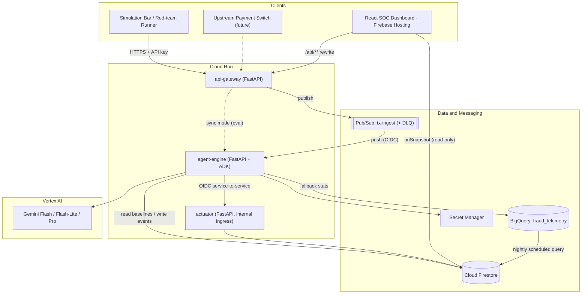
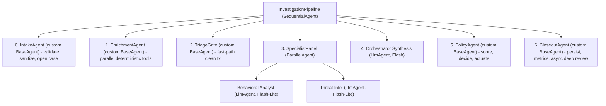
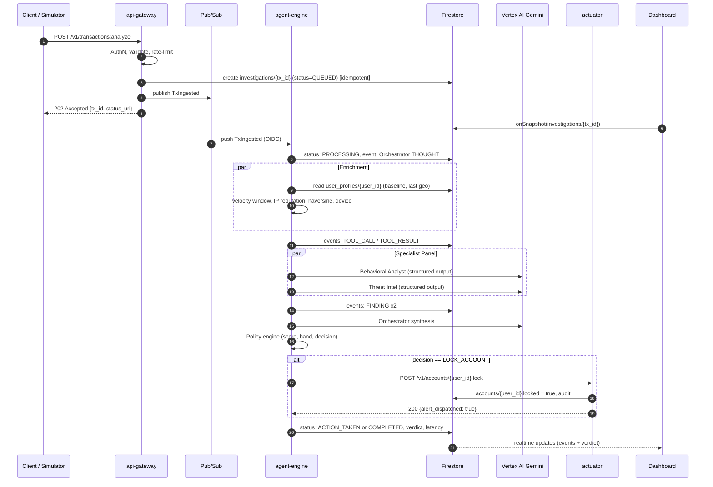

# 02 · System Architecture

| Field | Value |
|-------|-------|
| Status | ✅ Baseline v1.0 |
| Related | [04_AGENTS_SPEC](./04_AGENTS_SPEC.md) · [06_BACKEND_SPEC](./06_BACKEND_SPEC.md) · [08_DATA_SCHEMAS_API](./08_DATA_SCHEMAS_API.md) |

---

## 1. Architecture Principles

| # | Principle | Practical meaning |
|---|-----------|-------------------|
| P1 | **Facts are deterministic, reasoning is generative** | Tools compute numbers; LLMs interpret, correlate, and explain |
| P2 | **Policy owns actions** | No LLM output can directly trigger an irreversible side effect |
| P3 | **Everything observable** | Every agent step is an event in Firestore and a structured log with a trace ID |
| P4 | **Fail safe, never fail silent** | Timeouts lead to *degraded* verdicts with explicit flags, not crashes |
| P5 | **Hexagonal boundaries** | Domain logic is pure Python; GCP services sit behind ports with mock adapters |
| P6 | **Least privilege** | One service account per service; the actuator is isolated |
| P7 | **Config over code** | Models, thresholds, weights, and timeouts all come from env/config |

---

## 2. High-Level Logical Architecture

---

## 3. Microservice Decomposition

| Service | Runtime | Responsibility | Scales on | Ingress | Service Account |
|---------|---------|----------------|-----------|---------|-----------------|
| **api-gateway** | Cloud Run service | Auth, validation, idempotency, rate limit, publish to Pub/Sub, simulation scenarios, read APIs | HTTP RPS | Public (API key / Firebase ID token) | `sa-gateway` |
| **agent-engine** | Cloud Run service | ADK pipeline: enrichment, agents, synthesis, policy, telemetry, actuator calls | Pub/Sub push RPS | Internal + Pub/Sub push (OIDC) | `sa-agent-engine` |
| **actuator** | Cloud Run service | Account lock/unlock, tx block, alert dispatch (WhatsApp/SMS adapters), audit log | Low RPS | **Internal only**, invoker = `sa-agent-engine` + `sa-gateway` (analyst unlock) | `sa-actuator` |
| **sim-jobs** | Cloud Run **job** | Synthetic data generation, BigQuery load, red-team eval | On demand | n/a | `sa-sim` |
| **intel-refresh** | Cloud Run **job** + Scheduler | Refresh Tor exit list / IP reputation cache hourly | Cron | n/a | `sa-intel` |
| **dashboard** | Firebase Hosting | SPA, Firestore listeners, REST via hosting rewrites | CDN | Public (Firebase Auth) | n/a |

> [!TIP]
> **Hackathon shortcut.** `agent-engine` can be called synchronously by `api-gateway` (`ANALYZE_MODE=sync`) if Pub/Sub setup slips. The code path is identical; only the transport changes, because the gateway depends on an `InvestigationDispatcher` port with `PubSubDispatcher` and `HttpDispatcher` adapters.

---

## 4. Investigation Pipeline (ADK Agent Tree)

### Stage responsibilities

| Stage | Type | Deterministic? | Output (session state key) | Latency budget |
|-------|------|----------------|----------------------------|----------------|
| 0 Intake | Custom | ✅ | `tx`, `case_id` | 50 ms |
| 1 Enrichment | Custom (`asyncio.gather`) | ✅ | `features` (baseline, velocity, ip_rep, travel, device) | 350 ms |
| 2 Triage Gate | Custom | ✅ | `triage` = `FAST_ALLOW` or `INVESTIGATE` | 5 ms |
| 3 Specialist Panel | ParallelAgent → 2× LlmAgent | ❌ (LLM) | `behavioral_report`, `threat_report` | 900 ms |
| 4 Synthesis | LlmAgent | ❌ (LLM) | `orchestrator_assessment` (rationale + bounded adjustment) | 800 ms |
| 5 Policy | Custom | ✅ | `verdict` (score, band, decision, actions) | 300 ms (incl. actuator) |
| 6 Closeout | Custom | ✅ | Firestore summary, BigQuery row | 100 ms (async) |
| **Total** | | | | **≈ 2.5 s** |

**Fast path.** If the triage gate finds *no* risk signal (|z| < 2, known category, clean IP, no travel or velocity flags), the transaction is approved without LLM calls (latency ≈ 400 ms). The dashboard still shows a short telemetry trail (`Orchestrator: All signals nominal → ALLOW (fast path)`). Up to ~95 % of real traffic takes this path, which is the main lever for cost and latency.

**Demo visibility.** Stage 1 tool calls are attributed in the telemetry to the agent that "owns" each tool (baseline/velocity → Behavioral Analyst; IP/travel → Threat Intel). The UI therefore shows agents calling their tools while the system keeps its parallel, deterministic speed.

---

## 5. End-to-End Sequence

---

## 6. Data Responsibilities

| Store | Data | Why this store |
|-------|------|----------------|
| **Firestore** `investigations` + `events` | Live case state + ordered telemetry | Realtime listeners for the UI; low-latency writes |
| **Firestore** `user_profiles` | Baseline stats cache, last tx geo/time, known devices, recent tx ring buffer | Single-digit ms reads on the hot path |
| **Firestore** `accounts` | Lock status, lock history | Source of truth for actuator state (simulated core banking) |
| **BigQuery** `historical_txs` | 90-day+ transaction history | Analytics scale, SQL, scheduled queries |
| **BigQuery** `user_baselines` | Materialised per-user stats (nightly) | Feeds the Firestore cache; fallback on cache miss |
| **BigQuery** `investigation_results`, `eval_runs` | Every verdict + eval metrics | KPI dashboards, model governance, auditability |
| **Pub/Sub** `tx-ingest`, `tx-ingest-dlq` | Transaction events | Decoupling, retries, back-pressure |
| **Secret Manager** | API keys, OSINT keys, WhatsApp tokens | No secrets in env files or images |

---

## 7. Resilience & Failure Modes

| Failure | Detection | Behaviour | User-visible |
|---------|-----------|-----------|--------------|
| Gemini timeout / 429 / 5xx | `asyncio.timeout`, tenacity retry (1 retry, jittered) | Fallback model → then **deterministic-only verdict** | Event `ERROR` + verdict flagged `degraded=true` |
| Baseline cache miss | `None` from Firestore | BigQuery fallback (timeout 1.5 s) → population prior with `cold_start=true` | Event notes "cold start" |
| OSINT provider down | Adapter exception | Use cached list; if none, `ip_rep.unknown=true` with neutral weight | Event `ERROR` (non-fatal) |
| Actuator unavailable | HTTP error | Retry 2×; then status `ACTION_PENDING` and Pub/Sub retry of actuation command | Banner "Lock pending" |
| Duplicate `tx_id` | Firestore precondition failure | 409 Conflict, no re-processing | n/a |
| Poison message | Delivery attempts > 5 | Routed to DLQ, alert to ops | Case shows `FAILED` |
| LLM output invalid | Pydantic validation error | One re-ask with error feedback; else deterministic fallback | `degraded=true` |

**Timeout budget per stage** (configurable): enrichment 800 ms · each specialist 1.5 s · synthesis 1.5 s · actuator 1 s · pipeline hard cap 6 s.

---

## 8. Architecture Decision Records (ADRs)

> Store each ADR as its own file under `docs/adr/NNN-title.md` as the project evolves. Summaries:

### ADR-001 — Google ADK for orchestration
- **Context:** Need a hierarchical multi-agent structure, credible to judges, native to GCP.
- **Decision:** Use `google-adk` with `SequentialAgent`, `ParallelAgent`, `LlmAgent`, and custom `BaseAgent` subclasses.
- **Consequences:** + built-in session state, events, eval tooling, `adk web` debugging. − The framework evolves fast, so pin the version.

### ADR-002 — Deterministic scoring, bounded LLM adjustment
- **Decision:** The base score is a weighted sum of deterministic signals. The orchestrator LLM may adjust it by **±10** with a cited reason. Hard rules set score floors and ceilings.
- **Consequences:** Reproducible, auditable, explainable. Accuracy no longer depends on LLM arithmetic.

### ADR-003 — Flash-first model tiering
- **Decision:** Flash-Lite for specialists, Flash for the orchestrator, Pro only for async deep review in the REVIEW band.
- **Consequences:** Meets the < 2.8 s target at low cost. Pro-grade narrative is still available for analysts.

### ADR-004 — Pub/Sub decoupling with sync escape hatch
- **Decision:** Gateway publishes; engine consumes via push. `?mode=sync` exists for evaluation and latency tests.
- **Consequences:** Retries, DLQ, back-pressure. Slight latency overhead (~50–100 ms).

### ADR-005 — Firestore realtime + BigQuery analytics
- **Decision:** Hot state and telemetry live in Firestore; history and analytics live in BigQuery; a nightly sync bridges them.
- **Consequences:** Millisecond hot-path reads; BigQuery stays off the critical path.

### ADR-006 — Isolated actuator service
- **Decision:** Account-lock capability lives in its own service with internal ingress and a dedicated SA.
- **Consequences:** A compromised engine can't call core banking directly beyond the actuator's narrow API. Every action is audited.

### ADR-007 — Ports & adapters with MOCK mode
- **Decision:** Every external dependency (Gemini, Firestore, BigQuery, OSINT, actuator, notifier) is behind a `Protocol`, with `gcp` and `mock` adapters chosen by `AEGIS_ADAPTER_MODE`.
- **Consequences:** Offline demos, fast unit tests, deterministic evaluation.

---

## 9. Deployment Topology

| Item | Value |
|------|-------|
| Region | `us-central1` (Cloud Run, Firestore, BigQuery `US`), Vertex AI `global` endpoint or `us-central1` |
| Cloud Run settings (agent-engine) | min instances = 1 (no cold start in demo), CPU always allocated, concurrency 20, 1 vCPU / 1 GiB, timeout 30 s |
| Cloud Run settings (gateway) | min instances = 1, concurrency 80 |
| Cloud Run settings (actuator) | min instances = 0, internal ingress |
| Hosting | Firebase Hosting with rewrites `/api/**` → `api-gateway` (same origin, no CORS) |
| Environments | `local` (emulators + mock), `dev`, `demo` (judging) — separate GCP projects recommended |

> [!IMPORTANT]
> For BFSI data residency (e.g. UAE PDPL, GDPR) a production deployment would pin all resources to the customer's region (e.g. `me-central1` / `europe-west*`). Check Gemini model regional availability first.
