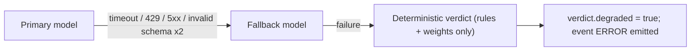

# 03 · AI Model Strategy (Gemini on Vertex AI)

| Field | Value |
|-------|-------|
| Status | ✅ Baseline v1.0 |
| Related | [04_AGENTS_SPEC](./04_AGENTS_SPEC.md) · [02_ARCHITECTURE](./02_ARCHITECTURE.md) |

---

## 1. Selection Principles

1. **Latency first on the hot path.** The < 2.8 s end-to-end target leaves roughly 1.7 s for *all* LLM work.
2. **Right-size each agent.** Specialists only interpret pre-computed features, so a small fast model is enough. The orchestrator correlates evidence and writes the rationale, so it gets a mid-tier model. Deep narrative uses the large model, off the hot path.
3. **Structured output everywhere.** Every agent returns a Pydantic-validated schema.
4. **Never hard-code model IDs.** All IDs come from env vars and are checked at build time.
5. **Graceful degradation.** Primary model → fallback model → deterministic verdict.

---

## 2. Recommended Model per Agent

| Agent / Use | Tier | Recommended model family | Why | Temp | Thinking | Max out tokens |
|-------------|------|--------------------------|-----|------|----------|----------------|
| **Orchestrator (Synthesis)** | Mid | **Gemini Flash** (latest GA) | Good multi-signal reasoning at sub-second latency; strong structured output | 0.1 | Low / minimal budget | 512 |
| **Behavioral Analyst** | Small | **Gemini Flash-Lite** (latest GA) | Interprets numeric features into findings; cheapest and fastest | 0.0 | Off / minimal | 384 |
| **Threat Intel** | Small | **Gemini Flash-Lite** (latest GA) | Interprets IP/geo features; same profile as Behavioral | 0.0 | Off / minimal | 384 |
| **Deep Review Narrative** (async, REVIEW band only) | Large | **Gemini Pro** (latest GA) | Long-form analyst case report, SAR-style narrative, counterfactuals | 0.2 | Medium | 2048 |
| **Analyst Copilot Q&A** (future) | Mid | Gemini Flash | Chat over a case's evidence | 0.3 | Low | 1024 |
| **Merchant similarity** (future) | Embedding | Gemini Embedding (latest) | Merchant/category clustering, novelty | — | — | — |

### Why not Pro for the orchestrator (as v0 suggested)?
- Pro-class models have noticeably higher time-to-first-token and lower throughput. Two sequential LLM hops (specialists → orchestrator) on Pro would usually exceed the 2.8 s budget on their own.
- The hard part of the analysis (math, rules) is already deterministic. The orchestrator's job is **correlation and explanation**, and Flash handles that well.
- Pro is still used where depth matters and latency doesn't: the **async deep-review** report for the ambiguous 31–70 band. That keeps the "uses Gemini Pro" story true for judges.

---

## 3. Model ID Configuration

```dotenv
# .env.example  (values MUST be verified against Model Garden before the build — see §3.1)
AEGIS_MODEL_ORCHESTRATOR=gemini-3-flash          # primary (latest GA Flash)
AEGIS_MODEL_ORCHESTRATOR_FALLBACK=gemini-2.5-flash
AEGIS_MODEL_SPECIALIST=gemini-3-flash-lite       # latest GA Flash-Lite
AEGIS_MODEL_SPECIALIST_FALLBACK=gemini-2.5-flash-lite
AEGIS_MODEL_DEEP_REVIEW=gemini-3.1-pro           # latest GA Pro
AEGIS_VERTEX_LOCATION=global                     # or us-central1
```

> [!WARNING]
> Gemini model IDs and lifecycles change often. **Gemini 1.5 models are retired**, and 2.x models have published retirement dates. The IDs above are *examples*. Before coding, run `task ai:models` (script `scripts/check_models.py`). It lists the publisher models available to your project and region, and it fails CI if a configured ID isn't available.

### 3.1 Model verification script (automated task)

```python
# scripts/check_models.py
"""Fail fast if any configured Gemini model ID is unavailable in this project/region."""

import os
import sys

from google import genai

REQUIRED_VARS = (
    "AEGIS_MODEL_ORCHESTRATOR",
    "AEGIS_MODEL_SPECIALIST",
    "AEGIS_MODEL_DEEP_REVIEW",
)


def main() -> int:
    client = genai.Client(
        vertexai=True,
        project=os.environ["GCP_PROJECT"],
        location=os.getenv("AEGIS_VERTEX_LOCATION", "global"),
    )
    available = {m.name.split("/")[-1] for m in client.models.list()}
    missing = [
        os.environ[v] for v in REQUIRED_VARS if os.environ.get(v) and os.environ[v] not in available
    ]
    if missing:
        print(f"❌ Unavailable models: {missing}")
        return 1
    print("✅ All configured models are available.")
    return 0


if __name__ == "__main__":
    sys.exit(main())
```

---

## 4. SDK Choices

| Concern | Choice | Notes |
|---------|--------|-------|
| Agent framework | **`google-adk`** | `SequentialAgent`, `ParallelAgent`, `LlmAgent`, custom `BaseAgent`; `adk web` for local debugging; `adk eval` for agent evals |
| Model client | **`google-genai`** (`genai.Client(vertexai=True, ...)`) | The unified, current SDK. Avoid the deprecated `vertexai.generative_models` surface in `google-cloud-aiplatform` |
| Structured output | `response_mime_type="application/json"` + `response_schema=<PydanticModel>` (ADK: `output_schema=`) | Guarantees parseable JSON |
| Retries | `tenacity` (exponential + jitter, max 1 retry on hot path) | Retry only 429/5xx/timeouts |
| Auth | Application Default Credentials (Cloud Run SA) | No API keys for Vertex |

> [!NOTE]
> In ADK, an `LlmAgent` with `output_schema` cannot also use tools in the same agent. That's one more reason for the design choice: **tools run in the deterministic Enrichment stage**, and specialists are pure structured-output interpreters. If a specialist ever needs live tool use, split it into a tool-using agent plus a formatter agent.

---

## 5. Latency Budget

| Step | Budget (p50) | Notes |
|------|--------------|-------|
| Gateway → Pub/Sub → engine | 150 ms | Push subscription, min-instances = 1 |
| Enrichment (parallel tools) | 350 ms | Firestore reads ~10–30 ms each; OSINT from cache |
| Specialist panel (parallel, Flash-Lite) | 900 ms | ~600 input tokens, ~200 output tokens each |
| Orchestrator synthesis (Flash) | 800 ms | ~1,200 input tokens, ~300 output tokens |
| Policy + actuator | 200 ms | Internal service call |
| Firestore writes (batched) | 100 ms | Overlapping with the above where possible |
| **Total** | **≈ 2.5 s** | Fast-path cases ≈ 0.4 s |

**Optimisation levers if over budget:**
1. Start orchestrator synthesis as soon as both specialist reports land (already sequential), and **stream** the rationale to Firestore.
2. Actuate as soon as the deterministic score crosses the hard-rule floor (e.g. Tor + impossible travel), *before* the LLM rationale finishes.
3. Disable/minimise thinking on specialists; trim prompts; cache system instructions (context caching) if supported for the chosen model.
4. Use the `global` endpoint for higher availability, or a regional endpoint co-located with Cloud Run for lower RTT. Benchmark both.

---

## 6. Token & Cost Envelope (per investigated transaction)

| Call | Input tokens | Output tokens |
|------|--------------|---------------|
| Behavioral Analyst | ~700 | ~200 |
| Threat Intel | ~700 | ~200 |
| Orchestrator | ~1,400 | ~350 |
| **Total (hot path)** | **~2,800** | **~750** |
| Deep review (REVIEW band only, ~3 % of txs) | ~3,000 | ~1,500 |

With the fast path skipping the LLM for clean traffic, the average cost per transaction is a small fraction of the investigated-case cost. Look up current per-token prices on the Vertex AI pricing page and record the computed figure in the pitch deck.

---

## 7. Prompt Engineering Standards

| Rule | Detail |
|------|--------|
| **Prompts are code** | Stored in `services/agent-engine/src/aegis_engine/prompts/*.md` with a front-matter `version:`; loaded by a `PromptRegistry` |
| **Version stamping** | Every verdict stores `{agent: {model_id, prompt_version}}` for auditability |
| **Data vs instruction separation** | Transaction data is passed inside a fenced `<transaction_data>` JSON block, and the prompt says it is untrusted data |
| **Evidence-only reasoning** | Agents may only cite keys present in `features`; a post-validator rejects rationales that reference unknown evidence IDs |
| **No PII beyond need** | User IDs are pseudonymised (`USR_…` hash); raw IPs reduced to reputation features in the orchestrator context |
| **Golden tests** | Each prompt has ≥ 20 golden cases in `tests/golden/`; CI runs them against mock *and* (nightly) real models |
| **Safety settings** | Default Vertex safety filters; outputs are schema-constrained so free-text harm risk is minimal |

---

## 8. Fallback Chain



The deterministic verdict is always computed first (Policy stage input), so a degraded result never blocks containment of critical fraud.
