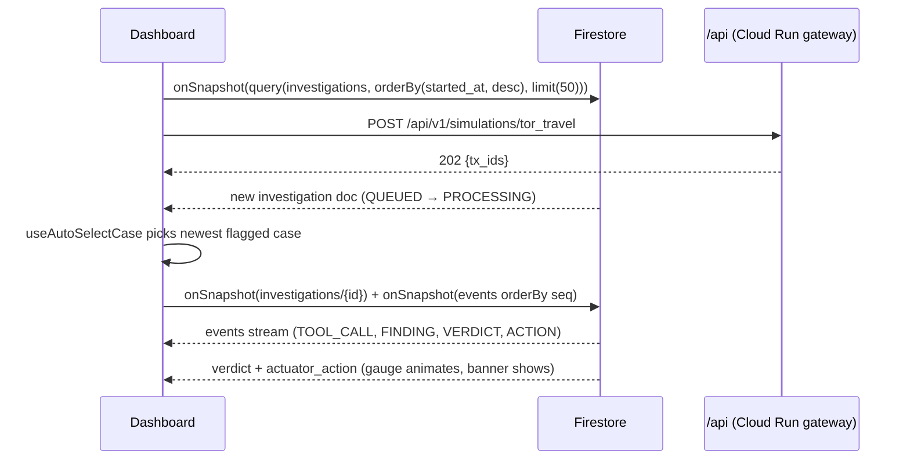

# 07 · Frontend Specification — SOC Dashboard

| Field | Value |
|-------|-------|
| Status | ✅ Baseline v1.0 |
| Related | [05_FEATURES_REQUIREMENTS](./05_FEATURES_REQUIREMENTS.md) · [08_DATA_SCHEMAS_API](./08_DATA_SCHEMAS_API.md) |

---

## 1. Technology Stack

| Concern | Choice | Notes |
|---------|--------|-------|
| Framework | **React 18** + **TypeScript (strict)** | As per spec |
| Build tool | **Vite** | `npm create vite@latest -- --template react-ts` |
| Styling | **Tailwind CSS v4** (`@tailwindcss/vite`) + CSS variables design tokens | Tokens defined in `index.css` via `@theme` |
| Realtime | **Firebase JS SDK (modular)**: Firestore `onSnapshot`, Auth, App Check | |
| Server state (REST) | TanStack Query | Mutations for simulations/decisions |
| UI state | Zustand | Selected case, pinned flag, filters |
| Animation | Motion (`motion/react`) | Respect `prefers-reduced-motion` |
| Icons | lucide-react | |
| Charts (KPI sparkline) | Lightweight SVG (custom) or Recharts | |
| Lint / format | ESLint (typescript-eslint, react-hooks, jsx-a11y) + Prettier | |
| Tests | Vitest + React Testing Library; Playwright E2E | |

---

## 2. Visual Design System ("Midnight SOC")

**Mood:** premium dark security-operations centre, glassmorphism panels, neon accent glows, monospaced telemetry.

### 2.1 Design tokens
```css
/* frontend/src/index.css */
@import "tailwindcss";

@theme {
  --font-sans: "Inter", ui-sans-serif, system-ui, sans-serif;
  --font-mono: "JetBrains Mono", ui-monospace, monospace;

  --color-bg:         hsl(228 39% 6%);    /* app background */
  --color-surface:    hsl(228 30% 10% / 0.72); /* glass panels */
  --color-border:     hsl(228 25% 22% / 0.6);
  --color-text:       hsl(220 20% 92%);
  --color-muted:      hsl(222 12% 60%);

  --color-brand:      hsl(258 90% 66%);   /* Aegis violet */
  --color-brand-2:    hsl(190 95% 55%);   /* cyan accent */

  --color-risk-low:      hsl(152 70% 48%);
  --color-risk-elevated: hsl(42 96% 56%);
  --color-risk-high:     hsl(24 95% 58%);
  --color-risk-critical: hsl(350 90% 60%);

  --color-agent-orchestrator: hsl(258 90% 70%);
  --color-agent-behavioral:   hsl(190 95% 60%);
  --color-agent-threat:       hsl(330 85% 65%);
  --color-agent-policy:       hsl(42 96% 60%);
  --color-agent-actuator:     hsl(350 90% 64%);

  --radius-panel: 1rem;
  --shadow-glow: 0 0 0 1px var(--color-border), 0 8px 40px -12px hsl(258 90% 50% / 0.35);
}
```

### 2.2 Visual rules
- Background: subtle radial gradients (violet top-left, cyan bottom-right) and a faint animated grid/noise layer.
- Panels: `backdrop-blur-xl`, translucent surface, 1 px border, glow shadow on focus/active.
- Typography: Inter for UI, JetBrains Mono for telemetry, IDs, and amounts.
- Status pills: `CLEAN` (green), `REVIEW` (amber), `BLOCKED` (orange), `LOCKED` (red, pulsing ring).
- Micro-interactions: row slide-in for new transactions, gauge sweep, typing caret, button press scale 0.97, a shimmer while a case is processing.

---

## 3. Layout

```text
┌──────────────────────────────────────────────────────────────────────────────┐
│ Header: 🛡 Aegis AI Fraud Ops · env badge · system health dots · KPI strip   │
├──────────────────────────────────────────────────────────────────────────────┤
│ Simulation Bar: [☕ Clean Coffee $4.50] [💸 Smurfing $9,800] [🧅 Tor Travel $12,500] │
├───────────────────────────────┬──────────────────────────────────────────────┤
│ Transaction Feed (≈ 40 %)     │ Investigation View (≈ 60 %)                  │
│ ┌───────────────────────────┐ │ ┌──────────────┐  ┌────────────────────────┐ │
│ │ time · user · merchant ·  │ │ │ ThreatGauge  │  │ Case summary card      │ │
│ │ amount · pill             │ │ │  (radial)    │  │ typology · decision    │ │
│ │ … rolling 50 rows         │ │ └──────────────┘  └────────────────────────┘ │
│ └───────────────────────────┘ │ ⚠ Account Locked banner (conditional)        │
│                               │ AgentChatLog (terminal, live events)         │
│                               │ Evidence chips · Deep Review (expandable)    │
│                               │ Analyst actions: Approve / Confirm / Unlock  │
└───────────────────────────────┴──────────────────────────────────────────────┘
```
Responsive: ≥ 1280 px two columns; 768–1279 px stacked with sticky gauge; < 768 px tabbed (Feed / Investigation).

---

## 4. Folder Structure (feature-based)

```text
frontend/
├── index.html                      # <title>, meta description, fonts preconnect
├── public/ (favicon.svg, og-image.png)
├── src/
│   ├── main.tsx                    # providers: QueryClient, Firebase, Router
│   ├── App.tsx                     # layout shell
│   ├── index.css                   # Tailwind + tokens
│   ├── config/env.ts               # typed import.meta.env access (zod-validated)
│   ├── services/
│   │   ├── firebase.ts             # initializeApp, getFirestore, Auth, App Check
│   │   └── api.ts                  # fetch wrapper → /api/** (same-origin), problem+json errors
│   ├── types/                      # generated from backend JSON Schemas (see §8)
│   ├── hooks/
│   │   ├── useInvestigationsFeed.ts   # onSnapshot query (limit 50)
│   │   ├── useInvestigation.ts        # doc + events sub-collection listeners
│   │   ├── useAutoSelectCase.ts       # FR-UI-02 logic
│   │   ├── useTypewriter.ts
│   │   └── useReducedMotion.ts
│   ├── store/uiStore.ts            # Zustand: selectedTxId, pinned
│   ├── components/
│   │   ├── layout/Header.tsx
│   │   ├── layout/KpiStrip.tsx
│   │   ├── simulation/SimulationBar.tsx
│   │   ├── feed/TransactionFeed.tsx
│   │   ├── feed/TransactionRow.tsx
│   │   ├── feed/StatusPill.tsx
│   │   ├── investigation/InvestigationView.tsx
│   │   ├── investigation/ThreatGauge.tsx
│   │   ├── investigation/AgentChatLog.tsx
│   │   ├── investigation/TelemetryLine.tsx
│   │   ├── investigation/LockBanner.tsx
│   │   ├── investigation/EvidenceChips.tsx
│   │   ├── investigation/DeepReviewPanel.tsx
│   │   ├── investigation/AnalystActions.tsx
│   │   └── ui/ (Panel.tsx, Button.tsx, Badge.tsx, Toast.tsx, Skeleton.tsx)
│   └── lib/ (format.ts, risk.ts, cn.ts)
├── tests/ (unit/, e2e/)
├── firebase.json · .firebaserc · firestore.rules · firestore.indexes.json
├── vite.config.ts · tsconfig.json · eslint.config.js · .prettierrc
└── package.json
```

---

## 5. Component Contracts

| Component | Props | Behaviour |
|-----------|-------|-----------|
| `Header` | — | Brand, env badge (`VITE_AEGIS_ENV`), service health from `/healthz` polling (30 s) |
| `KpiStrip` | — | `useQuery(['metrics'])` every 10 s; animated number counters |
| `SimulationBar` | — | 3 buttons → `POST /api/v1/simulations/{scenario}`; disabled while pending; toast on completion; IDs `sim-btn-coffee`, `sim-btn-smurfing`, `sim-btn-tor-travel` |
| `TransactionFeed` | `items: InvestigationSummary[]`, `selectedId`, `onSelect` | Virtualised list not needed (≤ 50); new rows animate in; keyboard ↑/↓ navigation |
| `StatusPill` | `decision`, `status` | Maps to CLEAN / REVIEW / BLOCKED / LOCKED / PROCESSING (shimmer) |
| `InvestigationView` | `txId` | Composes gauge, summary, banner, chat log, evidence, actions |
| `ThreatGauge` | `score: number \| null`, `band` | SVG arc (`stroke-dasharray`), animates 0 → score over 1.2 s; colour interpolates by band; centre numeric counter; ARIA `role="meter"` |
| `AgentChatLog` | `events: TelemetryEvent[]` | Auto-scroll unless the user scrolled up; agent pills with colour tokens; typing effect only for the newest event; `aria-live="polite"` |
| `LockBanner` | `actuator: ActuatorAction` | Visible if `account_locked`; red glass panel, pulse icon, channel info |
| `EvidenceChips` | `cited: string[]`, `features` | Hover tooltip shows the evidence value (e.g. `travel.speed_kmh = 27,350`) |
| `DeepReviewPanel` | `deepReview?: CaseNarrative` | Collapsible; skeleton while pending |
| `AnalystActions` | `txId`, `decision` | Approve / Confirm Fraud / Unlock with required reason modal; role-gated |

---

## 6. Realtime Data Flow



Rules:
- Unsubscribe listeners on unmount and when the selection changes (in the hook's `useEffect` cleanup).
- Firestore **offline persistence disabled** for the dashboard (always-live data).
- Clients never write to Firestore. All mutations go through the API.

---

## 7. Environment Variables

```dotenv
VITE_AEGIS_ENV=demo
VITE_FIREBASE_API_KEY=...
VITE_FIREBASE_AUTH_DOMAIN=...
VITE_FIREBASE_PROJECT_ID=...
VITE_FIREBASE_APP_ID=...
VITE_APPCHECK_RECAPTCHA_KEY=...
VITE_USE_EMULATORS=false        # true in local dev → connectFirestoreEmulator
```

`firebase.json` (same-origin API, SPA fallback):
```json
{
  "hosting": {
    "public": "dist",
    "ignore": ["firebase.json", "**/.*", "**/node_modules/**"],
    "rewrites": [
      { "source": "/api/**", "run": { "serviceId": "aegis-api-gateway", "region": "us-central1" } },
      { "source": "**", "destination": "/index.html" }
    ],
    "headers": [
      { "source": "**/*.@(js|css|woff2)", "headers": [{ "key": "Cache-Control", "value": "public,max-age=31536000,immutable" }] },
      { "source": "**", "headers": [
        { "key": "Strict-Transport-Security", "value": "max-age=63072000; includeSubDomains" },
        { "key": "X-Content-Type-Options", "value": "nosniff" },
        { "key": "Referrer-Policy", "value": "strict-origin-when-cross-origin" }
      ]}
    ]
  },
  "firestore": { "rules": "firestore.rules", "indexes": "firestore.indexes.json" },
  "emulators": { "firestore": { "port": 8081 }, "auth": { "port": 9099 }, "ui": { "enabled": true } }
}
```

> The gateway mounts its routes under `/api` as well as at the root, so `/api/v1/...` works through the rewrite.

---

## 8. Type Safety Across the Stack

- Backend Pydantic models are exported as JSON Schema (`task schemas:export` → `contracts/jsonschema/*.json`).
- The frontend generates TS types with `json-schema-to-typescript` (`npm run gen:types` → `src/types/generated/`).
- CI fails if the generated types differ from the committed ones (contract drift check).

---

## 9. Quality, Performance & Accessibility

| Area | Rule |
|------|------|
| Performance | Lighthouse ≥ 90 (Perf/Best Practices/SEO); code-split Deep Review panel; fonts `display=swap` |
| SEO | Single `<h1>` ("Aegis AI Fraud Ops"); descriptive `<title>` and meta description; semantic `<header> <main> <section> <aside>` |
| Accessibility | WCAG 2.2 AA contrast; `aria-live` for telemetry; focus rings; full keyboard support; reduced motion disables typing & sweep |
| Testability | Every interactive element has a unique, stable `id` / `data-testid` |
| Errors | Global error boundary; problem+json errors shown as toasts with `trace_id` |
