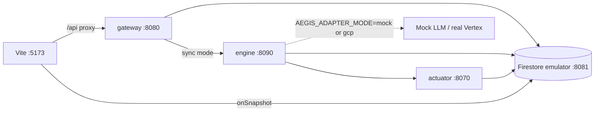
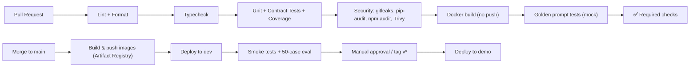

# 10 · DevOps, CI/CD & Automation

| Field | Value |
|-------|-------|
| Status | ✅ Baseline v1.0 |
| Related | [02_ARCHITECTURE §9](./02_ARCHITECTURE.md#9-deployment-topology) · [12_SECURITY_COMPLIANCE](./12_SECURITY_COMPLIANCE.md) |

---

## 1. Environments

| Env | Purpose | GCP project | Adapters | Data |
|-----|---------|-------------|----------|------|
| `local` | Dev on laptop | none (emulators) | `mock` + Firestore emulator | Seeded fixtures |
| `dev` | Integration, nightly eval | `aegis-dev-<id>` | `gcp` | Synthetic |
| `demo` | Judging / video recording | `aegis-demo-<id>` | `gcp` | Synthetic, frozen dataset version |

> [!TIP]
> Freeze the `demo` env 24 h before judging: pin image digests, disable auto-deploy, keep min-instances = 1, and pre-warm with `task demo:warmup`.

---

## 2. Automated Tasks (`Taskfile.yml`)

[go-task](https://taskfile.dev) is cross-platform (works natively on Windows PowerShell), so `make` isn't needed.

| Task | What it does |
|------|--------------|
| `task setup` | Install uv, sync Python workspace, `npm ci` in frontend, install pre-commit hooks |
| `task dev` | Start Firestore/Auth emulators, seed data, run gateway (8080), engine (8090), actuator (8070), Vite (5173) in parallel |
| `task lint` | `ruff check`, `ruff format --check`, `eslint`, `prettier --check` |
| `task typecheck` | `mypy --strict` on all packages, `tsc --noEmit` |
| `task test` | `pytest` (unit + contract) with coverage; `vitest run` |
| `task test:integration` | pytest against emulators |
| `task test:e2e` | Playwright against local stack |
| `task test:golden` | Golden prompt tests (mock); `REAL_LLM=1` hits Vertex AI |
| `task schemas:export` | Pydantic → `contracts/jsonschema/` → TS types |
| `task ai:models` | Run `scripts/check_models.py` |
| `task sim:generate` | Generate `historical_txs.csv` (seeded) |
| `task sim:load` | Create dataset/table and `bq load` with explicit schema |
| `task sim:baselines` | Run the baseline SQL and sync to Firestore (`jobs/baseline-sync`) |
| `task sim:redteam ENV=dev` | Build eval set and run the adversarial test; write report |
| `task build` | Build all Docker images locally |
| `task deploy:infra ENV=…` | Terraform apply (or `infra/scripts/bootstrap`) |
| `task deploy:services ENV=…` | Build & push to Artifact Registry, deploy Cloud Run services |
| `task deploy:frontend ENV=…` | `npm run build` + `firebase deploy --only hosting,firestore` |
| `task deploy:all ENV=…` | infra → services → frontend |
| `task demo:warmup` | Fire 20 mixed scenarios to warm instances and caches |
| `task clean` | Remove build artefacts and caches |

```yaml
# Taskfile.yml (excerpt)
version: "3"
dotenv: [".env"]
tasks:
  setup:
    cmds:
      - uv sync --all-packages
      - npm --prefix frontend ci
      - uv run pre-commit install
  lint:
    cmds:
      - uv run ruff check .
      - uv run ruff format --check .
      - npm --prefix frontend run lint
  test:
    cmds:
      - uv run pytest -m "not integration and not e2e" --cov --cov-fail-under=85
      - npm --prefix frontend run test -- --run
  dev:
    deps: [dev:emulators, dev:gateway, dev:engine, dev:actuator, dev:web]
```

---

## 3. Local Development



- `AEGIS_ANALYZE_MODE=sync` locally (no Pub/Sub emulator required; the Pub/Sub emulator is optional).
- `AEGIS_ADAPTER_MODE=mock` uses deterministic fake LLM responses derived from features. Set `gcp` with ADC (`gcloud auth application-default login`) to hit real Gemini.
- Vite dev proxy: `/api` → `http://localhost:8080`.

---

## 4. CI Pipeline (GitHub Actions)



| Workflow | Trigger | Jobs |
|----------|---------|------|
| `ci.yml` | PR, push | lint, typecheck, test (matrix: services), frontend test/build, security scan, docker build, schema drift check |
| `deploy.yml` | push `main` (→ dev); tag `v*` (→ demo, needs approval) | auth via **Workload Identity Federation** (no JSON keys), build/push, `gcloud run deploy --image …@sha256`, firebase deploy, smoke |
| `nightly-eval.yml` | cron 02:00 UTC | Full 2,000-case red-team eval on `dev` with real Gemini; posts metrics to BigQuery and a summary to the job log; fails if targets regress |

---

## 5. Infrastructure as Code

**Preferred:** Terraform (`infra/terraform`), with a remote state bucket per env.

| Module | Resources |
|--------|-----------|
| `project_services` | Enable `run`, `aiplatform`, `firestore`, `bigquery`, `pubsub`, `secretmanager`, `artifactregistry`, `cloudscheduler`, `cloudbuild`, `iamcredentials`, `firebase` |
| `iam` | Service accounts + role bindings (see §6) |
| `artifact_registry` | Docker repo `aegis` |
| `firestore` | Native-mode DB, indexes, (rules deployed by Firebase CLI) |
| `bigquery` | Dataset `fraud_telemetry`, tables, scheduled query `user_baselines` |
| `pubsub` | `tx-ingest`, DLQ, push subscription with OIDC |
| `cloud_run_service` | gateway, engine, actuator (ingress, min instances, env, secrets) |
| `cloud_run_job` | baseline-sync, intel-refresh, sim-jobs |
| `scheduler` | Cron triggers for jobs |
| `secret_manager` | `aegis-api-keys`, `aegis-whatsapp-token`, `aegis-osint-key` (values set out-of-band) |

**Hackathon fallback:** `infra/scripts/bootstrap.ps1` / `bootstrap.sh` with idempotent `gcloud` commands that create the same resources.

---

## 6. IAM — Service Accounts & Roles (least privilege)

| SA | Roles |
|----|-------|
| `sa-gateway` | `roles/datastore.user`, `roles/pubsub.publisher` (topic-scoped), `roles/secretmanager.secretAccessor` (api-keys secret), `roles/run.invoker` (engine + actuator, for sync mode & unlock) |
| `sa-agent-engine` | `roles/aiplatform.user`, `roles/datastore.user`, `roles/bigquery.dataViewer` + `roles/bigquery.jobUser`, `roles/bigquery.dataEditor` (on `investigation_results` only), `roles/run.invoker` (actuator) |
| `sa-actuator` | `roles/datastore.user`, `roles/secretmanager.secretAccessor` (whatsapp token) |
| `sa-pubsub-invoker` | `roles/run.invoker` (engine) |
| `sa-jobs` | `roles/bigquery.jobUser`, `roles/bigquery.dataEditor` (dataset), `roles/datastore.user`, `roles/storage.objectAdmin` (intel bucket) |
| `sa-deployer` (CI via WIF) | `roles/run.admin`, `roles/artifactregistry.writer`, `roles/iam.serviceAccountUser` (on runtime SAs), `roles/firebasehosting.admin` |

---

## 7. Scheduled / Background Automation

| Job | Schedule | Runtime | Purpose |
|-----|----------|---------|---------|
| `user_baselines` scheduled query | Daily 01:00 UTC | BigQuery | Recompute 90-day baselines |
| `baseline-sync` | Daily 01:30 UTC | Cloud Run Job | Push baselines into Firestore `user_profiles` (batched writes) |
| `intel-refresh` | Hourly | Cloud Run Job | Download Tor bulk exit list + ASN/hosting lists → GCS + Firestore metadata |
| `nightly-eval` | Daily 02:00 UTC | GitHub Actions / Cloud Run Job | Red-team regression |
| `investigations-ttl` | Firestore TTL policy on `expire_at` | Firestore | Auto-delete demo cases after 30 days |
| Deep review | On REVIEW decision | Background task (Cloud Tasks in v2) | Gemini Pro narrative |

---

## 8. Deployment Commands (manual reference)

```bash
# One-time
gcloud config set project $GCP_PROJECT
gcloud services enable run.googleapis.com aiplatform.googleapis.com firestore.googleapis.com \
  bigquery.googleapis.com pubsub.googleapis.com secretmanager.googleapis.com \
  artifactregistry.googleapis.com cloudscheduler.googleapis.com
gcloud artifacts repositories create aegis --repository-format=docker --location=us-central1

# Build & deploy a service (repeat for each; build context = repo root)
IMG=us-central1-docker.pkg.dev/$GCP_PROJECT/aegis/agent-engine:$(git rev-parse --short HEAD)
docker build -f services/agent-engine/Dockerfile -t $IMG . && docker push $IMG
gcloud run deploy aegis-agent-engine --image $IMG --region us-central1 \
  --service-account sa-agent-engine@$GCP_PROJECT.iam.gserviceaccount.com \
  --ingress internal-and-cloud-load-balancing --no-allow-unauthenticated \
  --min-instances 1 --concurrency 20 --cpu 1 --memory 1Gi --no-cpu-throttling \
  --env-vars-file services/agent-engine/env.demo.yaml

gcloud run deploy aegis-api-gateway --image $GW_IMG --region us-central1 \
  --service-account sa-gateway@$GCP_PROJECT.iam.gserviceaccount.com \
  --allow-unauthenticated --min-instances 1 \
  --set-secrets AEGIS_API_KEYS=aegis-api-keys:latest
  # Public at the network level, but app-level auth (API key / Firebase ID token) is enforced.

# Frontend
npm --prefix frontend run build
firebase deploy --only hosting,firestore:rules,firestore:indexes
```

> [!NOTE]
> With `--ingress internal-and-cloud-load-balancing`, Pub/Sub push to the engine still works: Pub/Sub push counts as internal traffic for Cloud Run when the subscription uses OIDC auth in the same project. Verify this in the target project; if it's blocked, use `--ingress all` with `--no-allow-unauthenticated` (IAM still protects the service).

---

## 9. Observability & Alerting

| Signal | Tool | Alert |
|--------|------|-------|
| Request/latency per service | Cloud Run metrics | p95 > 4 s for 5 min |
| Pipeline stage spans | Cloud Trace (OTel) | — (dashboards) |
| Errors | Error Reporting | New error group |
| `aegis/degraded_total` | Log-based metric | > 5 % of cases in 10 min |
| DLQ depth | Pub/Sub metric | > 0 |
| Gemini 429s | Log-based metric | > 1 % |
| Budget | Cloud Billing budget | 50 / 90 / 100 % of hackathon budget |
