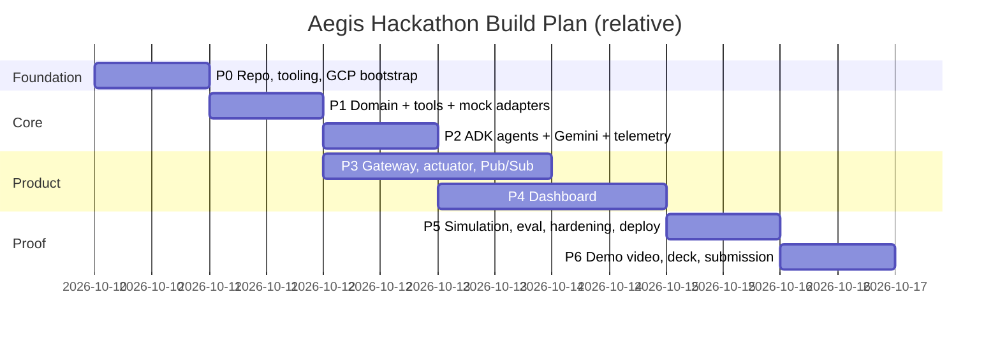

# 14 · Roadmap, Task Board & Demo Plan

| Field | Value |
|-------|-------|
| Status | ✅ Baseline v1.0 |
| Cadence | Hackathon sprint split into **6 phases** (scale to your deadline; ~1 day each for a 1-week build) |

---

## 1. Phase Plan (Hackathon MVP)

---

## 2. Task Board

Legend: **M** = Must · **S** = Should · **C** = Could · Est. in ideal hours

### P0 — Foundation
| ID | Task | Pri | Est | Depends | Done when |
|----|------|-----|-----|---------|-----------|
| AEG-01 | Init monorepo per [09](./09_REPOSITORY_STRUCTURE.md); uv workspace; Taskfile; pre-commit | M | 2 | — | `task setup && task lint` green |
| AEG-02 | GitHub repo, branch protection, CI skeleton (`ci.yml`) | M | 1.5 | 01 | PR shows required checks |
| AEG-03 | GCP projects (dev/demo), enable APIs, Artifact Registry, SAs/IAM (bootstrap script) | M | 2 | — | `infra/scripts/bootstrap` idempotent |
| AEG-04 | Firestore (native) + Firebase project link + emulators config | M | 1 | 03 | Emulator UI runs locally |
| AEG-05 | Run `task ai:models`; lock Gemini IDs in `.env.example` | M | 0.5 | 03 | Script passes |

### P1 — Domain, Tools & Data
| ID | Task | Pri | Est | Depends | Done when |
|----|------|-----|-----|---------|-----------|
| AEG-10 | `aegis-common` schemas (Transaction, Verdict, TelemetryEvent, enums) + JSON Schema export | M | 2 | 01 | Contracts generated |
| AEG-11 | Domain: geo (haversine), velocity/structuring, scoring, policy + `risk_policy.yaml` | M | 3 | 10 | ≥ 95 % coverage, boundary tests |
| AEG-12 | Ports + mock adapters (profiles, baselines, ip intel, actuator, telemetry, results) | M | 2 | 10 | Unit tests use mocks only |
| AEG-13 | Tools: baseline, velocity, ip_reputation, travel, device | M | 2.5 | 11, 12 | Tool tests green |
| AEG-14 | `generate_sims.py` (500 users, 10k txs, seeded, explicit schema) | M | 2 | 10 | CSV validates against `bq_schema.json` |
| AEG-15 | BigQuery load + `user_baselines` SQL + `baseline-sync` job | M | 2 | 14 | `user_profiles` populated |
| AEG-16 | Tor exit list + hosting ASN fixtures; `intel-refresh` job | S | 1.5 | 12 | IP lookup < 20 ms from cache |

### P2 — Agents & AI
| ID | Task | Pri | Est | Depends | Done when |
|----|------|-----|-----|---------|-----------|
| AEG-20 | Prompt registry + prompts v1.0.0 (behavioral, threat, orchestrator) | M | 1.5 | 10 | Loaded with versions |
| AEG-21 | Custom ADK agents: Intake, Enrichment, Triage, Policy, Closeout | M | 3 | 13 | Pipeline runs with mock LLM |
| AEG-22 | LlmAgents with `output_schema` (Flash-Lite ×2, Flash ×1) + ParallelAgent | M | 2 | 20 | Real Gemini returns valid reports |
| AEG-23 | TelemetryEmitter + Firestore sink (ordered seq, masking) | M | 1.5 | 12 | Events visible in emulator in order |
| AEG-24 | Fallback chain + degraded mode + per-stage timeouts | M | 1.5 | 22 | Forced timeout test passes |
| AEG-25 | Early containment on H1 | S | 1 | 21 | Lock fires before orchestrator verdict |
| AEG-26 | Golden prompt tests (≥ 20 per agent) | M | 2 | 22 | CI green (mock), nightly real |
| AEG-27 | DeepReview agent (Gemini Pro, async) | C | 2 | 22 | REVIEW case gets narrative < 15 s |

### P3 — Services
| ID | Task | Pri | Est | Depends | Done when |
|----|------|-----|-----|---------|-----------|
| AEG-30 | api-gateway: analyze (async/sync), v0 alias, validation, idempotency, problem+json | M | 3 | 10 | Contract tests green |
| AEG-31 | Auth: API key + Firebase ID token; rate limiting | M | 2 | 30 | 401/429 tests pass |
| AEG-32 | Simulation scenarios endpoint (coffee, smurfing, tor_travel) | M | 1.5 | 30 | Scenarios produce expected decisions |
| AEG-33 | Pub/Sub topic, DLQ, push subscription; engine push handler w/ OIDC verify | M | 2 | 21, 30 | End-to-end async flow works in dev |
| AEG-34 | actuator service: lock/unlock/block/alert, idempotency, audit | M | 2.5 | 12 | Lock reflected in Firestore + audit |
| AEG-35 | Metrics summary endpoint + `system/metrics` counters | S | 1 | 21 | KPI JSON served |
| AEG-36 | Dockerfiles (multi-stage, non-root) + Cloud Run deploy for all services | M | 2 | 30, 33, 34 | `dev` URLs healthy |

### P4 — Dashboard
| ID | Task | Pri | Est | Depends | Done when |
|----|------|-----|-----|---------|-----------|
| AEG-40 | Vite + React + TS + Tailwind v4 scaffold, tokens, fonts, layout shell | M | 2 | 01 | Lighthouse ≥ 90 on shell |
| AEG-41 | Firebase init, emulator switch, anonymous auth (viewer) | M | 1 | 40 | Listener reads emulator data |
| AEG-42 | TransactionFeed + StatusPill + auto-select hook | M | 2.5 | 41 | New cases slide in, pills correct |
| AEG-43 | InvestigationView: AgentChatLog (typing, agent pills, aria-live) | M | 3 | 41 | Ordered live events |
| AEG-44 | ThreatGauge (SVG, animated, role=meter) | M | 2 | 40 | Animates to score, band colours |
| AEG-45 | LockBanner + EvidenceChips + case summary | M | 1.5 | 43 | Banner on lock |
| AEG-46 | SimulationBar + toasts | M | 1 | 32 | 3 buttons work end-to-end |
| AEG-47 | KpiStrip + Header health | S | 1.5 | 35 | Live counters |
| AEG-48 | AnalystActions (unlock/override) + role gating | S | 2 | 34 | Audited unlock works |
| AEG-49 | DeepReviewPanel | C | 1 | 27 | Narrative renders |
| AEG-50 | Firebase Hosting deploy + `/api/**` rewrite | M | 1 | 36 | Same-origin calls work in `dev` |

### P5 — Proof & Hardening
| ID | Task | Pri | Est | Depends | Done when |
|----|------|-----|-----|---------|-----------|
| AEG-60 | `build_eval_set.py` (2,000 balanced, seeded) | M | 2 | 14 | Dataset + hash committed metadata |
| AEG-61 | `run_adversarial_test.py` + report + BigQuery `eval_runs` + `system/eval_latest` | M | 3 | 60, 33 | Report generated; exit code reflects targets |
| AEG-62 | Tune weights/prompts until targets met (record each policy version) | M | 3 | 61 | Accuracy > 98 %, FPR < 1.5 %, avg < 2.8 s |
| AEG-63 | Load test (20 tx/s) + latency optimisations | S | 2 | 36 | p95 < 4 s |
| AEG-64 | Security checklist ([12 §8](./12_SECURITY_COMPLIANCE.md#8-security-checklist-pre-demo)) | M | 1.5 | 36 | All items ticked |
| AEG-65 | Playwright E2E against `dev` | S | 2 | 46 | Green |
| AEG-66 | Deploy & freeze `demo`; `task demo:warmup` | M | 1 | all | Demo-ready checklist ([11 §7](./11_TESTING_EVALUATION.md#7-definition-of-demo-ready)) |

### P6 — Submission
| ID | Task | Pri | Est | Done when |
|----|------|-----|-----|-----------|
| AEG-70 | README polish + architecture diagram PNGs in `docs/diagrams/` | M | 1.5 | Judges can run/understand in 5 min |
| AEG-71 | 3-minute demo video (storyboard §3) | M | 3 | Uploaded, ≤ 3:00 |
| AEG-72 | Pitch deck PDF (outline §4) | M | 3 | Exported PDF |
| AEG-73 | Submission form + links (repo, Cloud Run, Hosting, video, deck) | M | 0.5 | Submitted |

---

## 3. Demo Video Storyboard (3:00)

| Time | Scene | On screen | Voice-over key line |
|------|-------|-----------|---------------------|
| 0:00–0:20 | Hook | Headline fraud-loss stats → Aegis logo | "Fraud moves in seconds. Investigations take hours. Aegis closes that gap." |
| 0:20–0:45 | Architecture | Animated ADK agent tree diagram | "A hierarchy of Gemini agents on Google ADK. Deterministic facts, generative reasoning, policy-owned actions." |
| 0:45–1:00 | Clean tx | Click ☕; green CLEAN in < 1 s | "Ninety-five percent of traffic takes the fast path. No LLM cost, no friction." |
| 1:00–1:40 | Smurfing | Click 💸; five rows; gauge 50 → 75 → 90; LOCK | "The Behavioral Analyst spots structuring under the $10k threshold, and the policy escalates automatically." |
| 1:40–2:25 | Tor ATO | Click 🧅; Threat Intel: Dubai→London in 12 min, Tor; lock banner **before** verdict text finishes | "Early containment: the account is frozen in under two seconds, then Gemini explains why." |
| 2:25–2:45 | Proof | Eval report: accuracy, FPR, latency; Cloud Trace waterfall | "Benchmarked on 2,000 labelled cases. These are real numbers." |
| 2:45–3:00 | Close | Impact metrics + Google Cloud stack logos | "Aegis: explainable, autonomous fraud defense, built on Google Cloud." |

---

## 4. Pitch Deck Outline (10–12 slides)

1. Title & team
2. Problem: losses, false positives, black-box scores
3. Solution: Aegis in one diagram
4. **Technical merit (40 %)**: hierarchical ADK tree, parallel specialists, structured outputs, bounded LLM authority
5. Architecture on Google Cloud (Cloud Run, Pub/Sub, Firestore, BigQuery, Vertex AI, Firebase)
6. Live telemetry: explainability by design (screenshot)
7. Scoring & policy: deterministic + LLM hybrid, 4 bands
8. Results: eval metrics, latency waterfall, cost per investigation
9. BFSI impact: fraud prevented, FPR reduction, analyst hours saved, compliance alignment
10. Security & Responsible AI
11. Roadmap
12. Ask / thank you

---

## 5. Risks & Mitigations

| Risk | Likelihood | Impact | Mitigation |
|------|-----------|--------|------------|
| Gemini model ID retired / unavailable in region | Med | High | `task ai:models` in CI; fallback model env vars; `global` endpoint |
| Latency over 2.8 s | Med | High | Fast path, Flash-Lite specialists, Firestore baselines, min-instances = 1, early containment |
| Gemini quota / 429 during live demo | Med | High | Request quota increase early; fallback model; deterministic degraded mode; pre-recorded video backup |
| ADK API changes | Med | Med | Pin exact version; thin wrapper around ADK in `agents/` |
| Pub/Sub / IAM setup issues | Med | Med | `AEGIS_ANALYZE_MODE=sync` escape hatch |
| Eval targets missed | Med | High | Weight tuning loop; hard-negative analysis; publish honest numbers |
| Scope creep | High | Med | MoSCoW discipline; "Could" items only after P5 |
| Cost overrun | Low | Med | Budget alerts; fast path; token caps |

---

## 6. Future Roadmap (post-hackathon)

| Horizon | Theme | Items |
|---------|-------|-------|
| **v1.1 (1 month)** | Productisation | Cloud Tasks for deep review; Cloud Armor; full analyst case management; WhatsApp Business API live adapter; multi-currency thresholds |
| **v1.5 (quarter)** | Smarter detection | BigQuery ML / Vertex AI tabular model as an additional signal; Vertex AI Feature Store / Bigtable for online features; Memorystore for velocity counters; device fingerprinting SDK |
| **v2.0 (6 months)** | Network intelligence | Graph analytics for mule/fraud rings (Spanner Graph / BigQuery graph); merchant embedding similarity; streaming with Dataflow; ISO 8583 / ISO 20022 adapters for real-time authorisation holds |
| **v2.5** | Agent ecosystem | A2A protocol for inter-bank intel-sharing agents; MCP servers exposing tools to analyst copilots; analyst copilot chat (Gemini) over case evidence; voice alerts via Gemini Live |
| **v3.0** | Enterprise SaaS | Multi-tenant isolation, per-tenant policy packs, regional deployments (me-central1, europe-west), SOC 2 / ISO 27001 readiness, model governance console |
